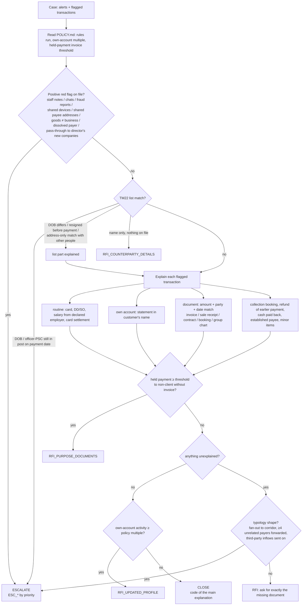

# Alert Closer — Track 1 (transaction-monitoring alert closing)

```
system/run <institution folder> <output.jsonl>
```

Reads only the institution folder, writes one JSON line per case
(`case_id`, `alert_ids`, `verdict`, `reason_code`, `reason`, `evidence`). Works from any directory.

**No model is used.** No LLM, no OpenRouter, no embeddings, no trained classifier, no network.
The engine is ~1,100 lines of plain Python 3 standard library (`system/tm.py`). It applies fixed rules
to the institution's own `POLICY.md`, the alerts, the transactions and the documents on file.
The same input always gives byte-identical output.

| | |
|---|---|
| Run time | ~1 s per 1,000-case institution on a laptop core (≈0.2 s for a 200-case hidden set) |
| Cost | **$0.00**. No API calls. |
| Dependencies | `python3` (3.8+) only |

## How it decides



Principles taken from the brief and policies:

* **A wrongful CLOSE is the most expensive mistake (10).** We close only when every flagged transaction is
  explained by a document whose amount, party and date line up, or is routine for the declared profile.
  Anything left unexplained becomes an RFI that asks for exactly the missing document.
* **ESCALATE needs a positive sign.** That means a red flag on file or a typology shape in the transactions;
  absence of documents alone is not enough. Escalation reasons never suggest asking the customer
  (tipping-off risk).
* **Policies differ per institution and are read, not hard-coded.** The rules that run, the own-account
  RFI multiple (5×) and the payments_fx £10,000 held-payment invoice threshold all come from `POLICY.md`.
* **A list match must be settled by evidence.** We look for a date of birth in any document (many
  formats). We check whether the listed person was an officer or PSC of the counterparty *on the payment date*,
  or resigned before it. We check address-only matches. With nothing on file the case is an RFI.
* **An earlier review covers only what it described.** New counterparties or amounts are not covered by it.
* **Fail-safe.** An unexpected error on one case produces ESCALATE for that case, never a crash or a silent close.

Reasons are 2–4 specific sentences. They name the amounts, dates, counterparties and document IDs, and for
an RFI they say what to ask for. Every ID in `evidence` exists in the folder (checked by `tests/validate.py`).

## Tests

```
system/run_all_tests.sh            # everything (QUICK=1 skips the stress harness)
```

| Suite | What it does | Result |
|---|---|---|
| `tests/test_policy.py` | 17 unit tests: verdict/code mapping, policy parsing (thresholds read from text, changed numbers honoured), date and amount parsing, name matching, red-flag wording | 17/17 |
| `tests/edge_cases.py` | 30 synthetic adversarial cases built from scratch (no dev data). Examples: a listed director resigned before vs after the payment, DOB mismatch, address-only list hits, a group company that is not in the structure, a dissolved payer, a held £10k payment with no invoice, a consultancy invoice for a produce importer, payees sharing addresses, a collection without a booking, refunds, a rule not run at the institution | 30/30 |
| `tests/stress.py` | Rewrites every case's documents 9 ways, the way hidden data might differ: shuffled order, US and slash dates, `GBP 1,234.00`, spaced thousands, plain labels, UPPER and lower case, synonyms. It then checks that no verdict moves in an unsafe direction (towards CLOSE) | 0 unsafe flips over 4 × 9 × 1,000 runs |
| `tests/validate.py` | Format: one line per case, alert IDs, verdict↔code family, 2–4 sentences, evidence IDs exist | 4,000 lines, 0 problems |
| determinism | Runs each institution twice and byte-compares the outputs | identical |

## Demo viewer

```
system/demo.sh institutions demo_out      # or a single institution folder
```

This runs the system with an engine trace (`TM_TRACE=<file>`), validates the output and builds one offline
`demo_out/index.html`. The page has no network calls and contains:
* stat cards and verdict mix per institution, plus a clickable reason-code chart;
* a searchable, filterable table;
* a case drawer showing the alerts, the declared profile, every flagged transaction with the engine's
  finding, red flags, list checks, previous reviews and the raw text of the cited documents.

Deep links use `index.html#CASE_ID`. The page embeds development data, so it is git-ignored.

## Known limitations

* Red flags in free text come from curated regular expressions. They are broad, and the stress harness tests
  them against paraphrases, but wording that is entirely new can be missed. A missed flag normally falls back
  to RFI rather than CLOSE, because the transaction is still unexplained.
* The goods-vs-business check uses a small category vocabulary (food, furniture, electronics, phones,
  clothing, consultancy…).
* Whether a case with no documents is an RFI or an ESCALATE is decided by transaction shape (fan-out, pass-through,
  many unrelated payers). That is a judgment call that hidden data could draw differently.
* There are no labels for the dev set. The expected verdict mix was inferred from the data's own structure:
  each documented story has a "no-document twin" that should be an RFI.
